<p align="center">
  
</p>

<p align="center">
  <b>Revisa lo que descargas antes de que toque tu compu.</b><br>
  Un ZIP, una skill, una carpeta de configuración o un repo de GitHub: Claude lo abre aparte,<br>
  lo lee sin ejecutar nada y te dice qué cambiaría, qué es sospechoso y si hace lo que promete.
</p>

<p align="center">
  <a href="#instalación">Instalación</a> ·
  <a href="#cómo-se-usa">Cómo se usa</a> ·
  <a href="#así-se-ve-una-ficha">La ficha</a> ·
  <a href="#si-ya-lo-abriste">Rescate</a> ·
  <a href="#qué-hace-por-dentro">Por dentro</a> ·
  <a href="README.en.md">English</a>
</p>

<p align="center">
  
  
  
  
</p>

---

## El problema

Te pasan una skill en un ZIP, encuentras una herramienta en GitHub o alguien te comparte su
"configuración pro". La abres con Claude Code y, sin que lo notes, te cambia los permisos, te deja
un hook que corre solo, te agrega una línea a `~/.zshrc` o se programa para arrancar con tu compu.

No hace falta que sea un virus. Una skill son archivos de texto que Claude lee como instrucciones, y
una carpeta puede traer su propio `.claude/settings.json`. Si ya confiaste en la carpeta de arriba,
sus hooks corren sin preguntarte.

## Lo que hace

| | |
|---|---|
| 🧪 **Lo aísla** | Lo copia a `~/cuarentena/`, deja fuera symlinks y rutas que intentan salirse, y le quita el permiso de ejecución a todo |
| 🔕 **Apaga lo que se carga solo** | Renombra `CLAUDE.md`, `.claude/`, `.mcp.json` y compañía para que sean texto y nada más |
| 🔎 **Busca señales** | Ocho categorías: permisos, hooks, MCP, escrituras fuera de su carpeta, instaladores, llaves, red, ofuscación, instrucciones escondidas para la IA |
| ⚖️ **Compara promesa contra código** | Lo que dice el README frente a lo que hace de verdad, con archivo y línea |
| 📋 **Te da un veredicto** | **Instalar**, **Instalar con cambios** o **No instalar**, más la instalación mínima si vale la pena |
| 🔒 **No deja ejecutar nada** | Un candado (hook) niega cualquier comando que corra algo de la cuarentena, aunque se lo pidas a Claude |

## Antes de instalarla, revísala

Es una herramienta de seguridad que alguien te está pasando, así que aplica la misma regla. Son
tres scripts de Bash, dos skills en Markdown y un hook, sin dependencias:

| Archivo | Qué hace |
|---|---|
| [`skills/revisar/scripts/aislar.sh`](skills/revisar/scripts/aislar.sh) | Copia o descomprime a `~/cuarentena/` sin ejecutar nada |
| [`skills/revisar/scripts/senales.sh`](skills/revisar/scripts/senales.sh) | Busca las señales con `grep`. Solo lee |
| [`skills/rescate/scripts/revisar-compu.sh`](skills/rescate/scripts/revisar-compu.sh) | Foto de solo lectura de tu configuración; tapa lo que parece secreto |
| [`hooks/candado.sh`](hooks/candado.sh) | Niega ejecutar cualquier cosa que esté en `~/cuarentena/` |

No manda datos a ningún lado. La única red que usa es `curl` para bajar un repo de GitHub como ZIP
cuando le pasas un link. Si no quieres instalar nada, la [guía](https://www.tododeia.com/community/cuarentena-claude)
trae un prompt para hacer la misma revisión en claude.ai.

## Instalación

Requisitos: [Claude Code](https://claude.com/claude-code) en macOS, Linux o WSL. Nada más.

Dentro de Claude Code:

```
/plugin marketplace add Hainrixz/cuarentena
/plugin install cuarentena@cuarentena
```

O desde la terminal:

```bash
claude plugin marketplace add Hainrixz/cuarentena
claude plugin install cuarentena@cuarentena
```

## Cómo se usa

```
/cuarentena:revisar ~/Downloads/la-skill.zip
/cuarentena:revisar ~/Downloads/carpeta-que-me-pasaron
/cuarentena:revisar https://github.com/alguien/herramienta
```

También se activa sola si le dices a Claude "¿es seguro instalar esto?" o "revisa este zip antes de
abrirlo".

Te contesta en el chat con el veredicto y deja la ficha completa en
`~/cuarentena/<nombre>-<fecha>/FICHA.md`. Si el veredicto lo permite, te propone la instalación
mínima: copiar a su lugar solo lo que hace falta, sin correr el instalador del autor. No hace nada
sin tu sí.

## Así se ve una ficha

Esta salió de una corrida real sobre el ZIP trampa de [`pruebas/`](pruebas/armar.py): promete ser una
skill que formatea notas, sin internet ni permisos. Todo apunta a `example.invalid`, que no existe.

> **Veredicto: No instalar**
> Promete solo formatear notas sin internet ni permisos, pero su instalador manda tus llaves SSH y de
> AWS a un servidor ajeno y deja programado código remoto que corre solo. Además trae instrucciones
> escondidas para que Claude no te avise.

| Lugar | Qué haría | ¿Lo avisa el README? | Riesgo |
|---|---|---|---|
| `~/.ssh/id_ed25519`, `~/.aws/credentials` | Los lee y los manda por POST a otro servidor | no | alto |
| `~/.zshrc` | Agrega una línea que baja y corre un script cada vez que abres la terminal | no | alto |
| `~/Library/LaunchAgents/` | Se programa para correr código remoto en cada inicio de sesión | no | alto |
| Claude Code | `Bash(*)` + `bypassPermissions` + un hook que corre el instalador al abrir sesión | no | alto |

La ficha completa, con las 9 señales y su línea: [`docs/ficha-ejemplo.md`](docs/ficha-ejemplo.md).

## Si ya lo abriste

```
/cuarentena:rescate
/cuarentena:rescate 30
```

El número son los días hacia atrás que marca como recientes (14 por defecto). Revisa en modo solo
lectura:

- la configuración global de Claude Code: permisos, hooks y `CLAUDE.md`;
- skills, plugins y servidores MCP;
- el arranque de la terminal;
- LaunchAgents y crontab;
- git, npm y `/etc/hosts`.

Te separa lo sospechoso de lo tuyo y te propone cómo deshacer cada cosa, una por una, con respaldo y
con tu permiso. Si algo leyó tus llaves y las mandó a internet, te dice cuáles cambiar.

## Qué hace por dentro

**1. Aislar sin ejecutar.** `aislar.sh` lista el ZIP antes de abrirlo. Las entradas con `..`, las
rutas absolutas y los symlinks no se extraen y quedan anotados: un paquete normal no los trae. Tiene
un tope de 1 GB descomprimido contra bombas zip.

**2. Apagar lo que se carga solo.** Claude Code carga el `CLAUDE.md` de una subcarpeta en cuanto lee
un archivo de ahí, y los hooks del `.claude/settings.json` de una carpeta pueden correr sin
preguntarte si ya confiaste en la de arriba. Con el sufijo `.cuarentena` son solo texto.

**3. Buscar señales.** `senales.sh` revisa ocho categorías:

| | Busca |
|---|---|
| A | Permisos amplios, `bypassPermissions`, hooks, servidores MCP, redirección de la API |
| B | Escrituras a `~/.claude`, `~/.zshrc`, LaunchAgents, crontab, `sudo`, git y npm globales |
| C | `postinstall`, `curl \| bash`, `eval` y compañía |
| D | Lectura de `~/.ssh`, `~/.aws`, `.env`, llaveros y tokens |
| E | Envíos a internet y la lista de dominios |
| F | base64 que se ejecuta, código ofuscado, caracteres invisibles |
| G | Instrucciones escondidas para la IA |
| H | Binarios que no se pueden leer |

**4. Leer y juzgar.** Claude abre lo que importa y decide con las reglas de
[`references/senales.md`](skills/revisar/references/senales.md). Todo lo que lee lo trata como dato:
si un archivo le pide algo, eso entra a la ficha como hallazgo.

**5. Segunda opinión.** Si tienes [SkillSpector](https://github.com/NVIDIA/skillspector) instalado,
también lo corre.

**El candado.** Un hook `PreToolUse` niega correr un script de `~/cuarentena/`, entrar con `cd` y
correr `npm install`, `chmod +x`, `open` o `source`. Funciona aunque estés en modo de permisos
saltados. Leer (`ls`, `cat`, `grep`) pasa.

## Lo que no ve

- **Binarios y código compilado.** No se pueden leer; la ficha lo dice y baja la confianza.
- **Lo que se baja después.** Si el paquete descarga un script el día que lo corres, la revisión ve
  que lo baja, no qué trae. Por eso `curl | bash` ya cuenta como señal.
- **Ofuscación fuerte.** Alguien decidido a esconder algo puede esquivar un `grep`.
- **No es un antivirus**, ni reemplaza una máquina virtual para código que de verdad no confías.

## Pruebas

```bash
bash pruebas/verificar.sh
```

Arma un ZIP trampa con 10 señales plantadas y uno limpio, y prueba los tres scripts y los 24 casos
del candado sin red y sin Claude.

## Guía

El paso a paso, con el camino en claude.ai para revisar sin instalar nada:
[tododeia.com/community/cuarentena-claude](https://www.tododeia.com/community/cuarentena-claude)

## Licencia

MIT. Hecho por [Enrique Rocha](https://github.com/Hainrixz) para la comunidad de
[Tododeia](https://www.tododeia.com).
